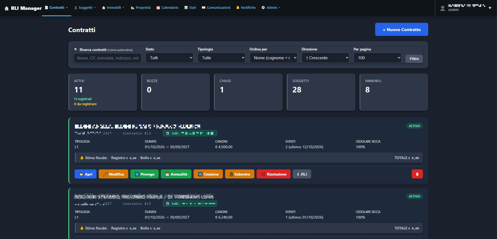
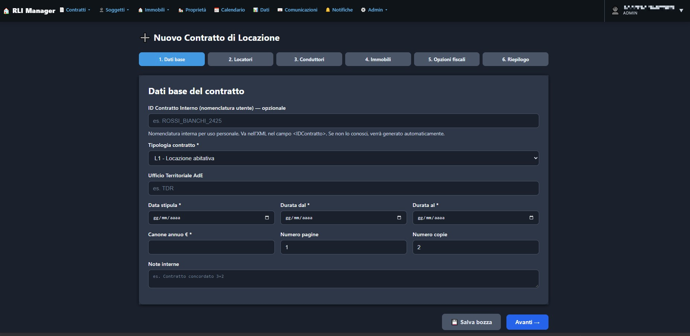

<p align="center">
  
</p>

<p align="center">
  
  
  
  
</p>

# RLI Manager

Gestionale web per la compilazione, il calcolo delle imposte e la generazione dei
file telematici **RLI12** conformi alle specifiche dell'**Agenzia delle Entrate**
(registrazione dei contratti di locazione e affini).

---

## Descrizione

RLI Manager è un'applicazione PHP/MySQL pensata per studi professionali e
intermediari che devono gestire contratti di locazione e trasmetterli
telematicamente. Le funzionalità principali includono:

- **Anagrafiche soggetti** (persone fisiche e società) con validazione del
  Codice Fiscale (algoritmo mod-26 con gestione delle omocodie), lookup locale
  dei comuni tramite **codici catastali Belfiore** e gestione degli **Stati
  Esteri** (codici `Zxxx`), PEC e legale rappresentante.
- **Anagrafiche immobili** con autocompletamento locale dei comuni, categoria
  catastale, rendita, flag pertinenza e duplicazione rapida.
- **Wizard contratti** guidato a step: selezione locatori/conduttori, immobili,
  quote di possesso e opzione **Cedolare Secca** per singolo locatore.
- **Calcolo imposte** di registro, bollo e **ravvedimento operoso** (sanzioni e
  interessi), con gestione del regime **Cedolare Secca totale o parziale**:
  - cedolare 100% → imposta di registro e di bollo a € 0,00;
  - cedolare parziale → imposta di registro proporzionale alla sola quota dei
    locatori in regime ordinario (minimo € 67 solo se dovuta imposta
    proporzionale > 0), bollo comunque dovuto.
- **Gestione eventi successivi**: proroghe, cessioni, risoluzioni, subentri,
  conguagli, rinegoziazioni e annualità successive.
- **Generazione e validazione XML** conforme allo schema XSD RLI12, con
  controllo pre-volo dei dati e validazione formale prima del download.
- **Interfaccia con Dark Mode** impostabile come preferenza dal profilo utente.
- **Registro comunicazioni** e template email con segnaposto dinamici.
- **Notifiche e scadenze** con task cron dedicati.

---

## 📸 Anteprima e Screenshot

| Dashboard | Wizard contratto |
|:---:|:---:|
|  |  |
| **Dashboard** — scadenze, contatori e stato contratti | **Wizard contratto** — calcolo Cedolare Secca e Ravvedimento |

| Anagrafica immobili | Dark Mode |
|:---:|:---:|
|  |  |
| **Immobili** — stato occupazione LIBERO/LOCATO e quote | **Dark Mode** — interfaccia a tema scuro |

---

## Requisiti tecnici

| Componente | Versione / Estensioni |
|------------|-----------------------|
| **PHP** | 8.x con estensioni `pdo_mysql`, `dom`, `xml`, `mbstring`, `openssl` |
| **Database** | MySQL 8.0+ oppure MariaDB 10.5+ |
| **Web server** | Apache (con `mod_rewrite`) oppure Nginx |
| **Composer** | Opzionale (per l'autoload delle classi in `lib/`) |

---

## Guida rapida all'installazione

### 1. Ottenere il codice

```bash
git clone <url-del-repository> RLI
cd RLI
```

### 2. Configurare l'applicazione

```bash
# Configurazione applicativa (costanti, chiavi, SMTP)
cp config.example.php config.php

# Connessione al database
cp db.example.php db.php
```

Aprire `config.php` e `db.php` e sostituire **tutti** i valori segnaposto
(`XXXXXXXXXXXXXXXX`, `cambiame`, `db_user`, ecc.) con i valori reali del proprio
ambiente. In alternativa è possibile creare un file `config.local.php` per
sovrascrivere solo alcune costanti senza modificare `config.php`.

> ⚠️ **Sicurezza**: non versionare mai `config.php`, `config.local.php` e
> `db.php` con credenziali reali. Sono già esclusi da `.gitignore`.

### 3. Creare il database e importare lo schema

```bash
# Creare il database
mysql -u root -p -e "CREATE DATABASE db_rli CHARACTER SET utf8mb4 COLLATE utf8mb4_unicode_ci;"

# Importare la struttura
mysql -u root -p db_rli < schema_db.sql

# Applicare le migrazioni (in ordine)
mysql -u root -p db_rli < migrations/002_allegati_su_disco.sql
mysql -u root -p db_rli < migrations/003_tema_utente.sql
mysql -u root -p db_rli < migrations/004_migliorie_soggetti.sql
mysql -u root -p db_rli < migrations/005_migliorie_immobili.sql
```

### 4. Popolare l'archivio dei comuni

Il lookup locale dei comuni (codici Belfiore) richiede il caricamento della
tabella `comuni` a partire da un file `comuni.json`:

```bash
php scripts/import_comuni.php
```

Lo script legge il file `comuni.json` (non incluso nel repository per dimensioni)
e popola la tabella `comuni` con codice catastale, nome e sigla provincia.

### 5. Impostare i permessi

Assicurarsi che il web server possa scrivere nelle directory di runtime
(log e storage esterno):

```bash
# Storage esterno alla document root (consigliato)
sudo mkdir -p /var/lib/rli_storage
sudo chown -R www-data:www-data /var/lib/rli_storage
sudo chmod -R 770 /var/lib/rli_storage

# Log applicativi
sudo chown -R www-data:www-data logs
sudo chmod -R 770 logs
```

Il percorso dello storage è configurabile tramite la costante
`RLI_STORAGE_PATH` (default `/var/lib/rli_storage` su Linux).

### 6. Primo accesso

Aprire l'applicazione nel browser e accedere con le credenziali amministrative
iniziali. Si raccomanda di cambiare immediatamente la password di default e di
configurare gli utenti dal pannello di amministrazione.

---

## Struttura del progetto

```
RLI/
├── index.php                 # Dashboard
├── soggetti.php              # Elenco anagrafiche soggetti
├── immobili.php              # Elenco anagrafiche immobili
├── contract_new.php          # Wizard creazione contratto
├── contract.php              # Scheda contratto
├── contract_event*.php       # Eventi successivi (proroga, cessione, ...)
├── genera_xml.php            # Generazione XML RLI12
├── valida_xml.php            # Validazione XSD
├── save_pratica.php          # Salvataggio pratica
├── lib/                      # Classi applicative (repository, calcolo, XML, ...)
├── assets/                   # CSS/JS (tema, dark mode, utility)
├── migrations/               # Migrazioni SQL incrementali
├── scripts/                  # Script di importazione (comuni)
├── xsd/                      # Schemi XSD RLI12
├── tests/                    # Test e scenari di validazione
├── schema_db.sql             # Struttura del database
├── config.example.php        # Template configurazione applicativa
├── db.example.php            # Template connessione database
└── LICENSE                   # Licenza FSL-1.1-MIT
```

---

## Licenza

Questo progetto è distribuito con licenza **Functional Source License, Version
1.1, MIT Future License (FSL-1.1-MIT)**. Il testo completo è disponibile nel
file [`LICENSE`](LICENSE).

### Cosa è consentito

- Uso **interno** e personale del software.
- **Modifica** e creazione di opere derivate.
- Uso per **educazione e ricerca non commerciali**.
- Erogazione di servizi professionali a un licenziatario che utilizza il
  software nel rispetto dei termini.

### Cosa è espressamente VIETATO

- **Rivendita** del software o di opere derivate.
- **Distribuzione a pagamento** verso terzi.
- **Erogazione come servizio commerciale o SaaS** a terzi che sostituisca o
  offra funzionalità sostanzialmente equivalenti al software (cd. *Competing
  Use*).
- Qualsiasi forma di **sfruttamento commerciale verso terzi** non espressamente
  autorizzata.

### Conversione futura

Trascorsi **due anni** dalla pubblicazione di ciascuna release, la stessa
release viene resa disponibile anche con licenza **MIT**, come descritto nella
sezione *MIT Future License* del file `LICENSE`.

---

## Disclaimer

Il software viene fornito "così com'è", senza garanzie di alcun tipo. L'utente è
l'unico responsabile della verifica della correttezza dei dati trasmessi
all'Agenzia delle Entrate e del rispetto della normativa fiscale vigente.
