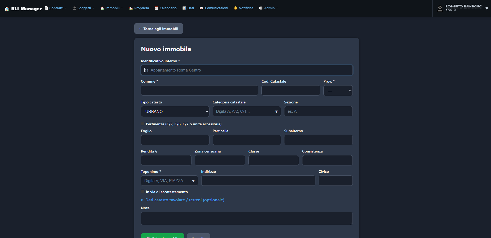
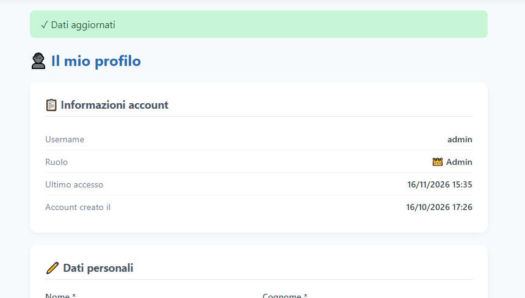

<p align="center">
  
</p>

<p align="center">
  
  
  
  
</p>

# RLI Manager

Gestionale web per la compilazione, il calcolo delle imposte e la generazione dei
file telematici **RLI12** conformi alle specifiche dell'**Agenzia delle Entrate**
(registrazione dei contratti di locazione e affini).

---

## Descrizione

RLI Manager è un'applicazione PHP/MySQL pensata per studi professionali e
intermediari che devono gestire contratti di locazione e trasmetterli
telematicamente. Le funzionalità principali includono:

- **Anagrafiche soggetti** (persone fisiche e società) con validazione del
  Codice Fiscale (algoritmo mod-26 con gestione delle omocodie), lookup locale
  dei comuni tramite **codici catastali Belfiore** e gestione degli **Stati
  Esteri** (codici `Zxxx`), PEC e legale rappresentante.
- **Anagrafiche immobili** con autocompletamento locale dei comuni, categoria
  catastale, rendita, flag pertinenza e duplicazione rapida.
- **Wizard contratti** guidato a step: selezione locatori/conduttori, immobili,
  quote di possesso e opzione **Cedolare Secca** per singolo locatore.
- **Calcolo imposte** di registro, bollo e **ravvedimento operoso** (sanzioni e
  interessi), con gestione del regime **Cedolare Secca totale o parziale**:
  - cedolare 100% → imposta di registro e di bollo a € 0,00;
  - cedolare parziale → imposta di registro proporzionale alla sola quota dei
    locatori in regime ordinario (minimo € 67 solo se dovuta imposta
    proporzionale > 0), bollo comunque dovuto.
- **Gestione eventi successivi**: proroghe, cessioni, risoluzioni, subentri,
  conguagli, rinegoziazioni e annualità successive.
- **Generazione e validazione XML** conforme allo schema XSD RLI12, con
  controllo pre-volo dei dati e validazione formale prima del download.
- **Interfaccia con Dark Mode** impostabile come preferenza dal profilo utente.
- **Registro comunicazioni** e template email con segnaposto dinamici.
- **Notifiche e scadenze** con task cron dedicati.

---

## 📸 Anteprima e Screenshot

| Dashboard | Wizard contratto |
|:---:|:---:|
|  |  |
| **Dashboard** — scadenze, contatori e stato contratti | **Wizard contratto** — calcolo Cedolare Secca e Ravvedimento |

| Anagrafica immobili | Dark Mode |
|:---:|:---:|
|  |  |
| **Immobili** — stato occupazione LIBERO/LOCATO e quote | **Dark Mode** — interfaccia a tema scuro |

---

## Requisiti tecnici

| Componente | Versione / Estensioni |
|------------|-----------------------|
| **PHP** | 8.x con estensioni `pdo_mysql`, `dom`, `xml`, `mbstring`, `openssl` |
| **Database** | MySQL 8.0+ oppure MariaDB 10.5+ |
| **Web server** | Apache (con `mod_rewrite`), Nginx oppure XAMPP (Windows/macOS) |
| **Composer** | Opzionale (per l'autoload delle classi in `lib/`) |

---

## Guida rapida all'installazione

### Opzione A — Installazione su Windows con XAMPP

1. **Scaricare i file nella cartella `htdocs`:**
   - Scarica o clona il repository dentro `C:\xampp\htdocs\RLI`:
     ```cmd
     cd C:\xampp\htdocs
     git clone [https://github.com/eikaf/rli-manager.git](https://github.com/eikaf/rli-manager.git) RLI
     ```
2. **Verificare le estensioni PHP:**
   - Dal **Pannello di Controllo di XAMPP**, clicca su **Config → PHP (`php.ini`)** accanto ad Apache e assicurati che siano attive (senza `;` davanti) le estensioni `pdo_mysql`, `mbstring`, `openssl`, `xml` e `dom`.
   - Avvia i moduli **Apache** e **MySQL**.
3. **Configurare database e percorsi:**
   - Duplica `config.example.php` in `config.php` e `db.example.php` in `db.php`.
   - In `db.php`, imposta i parametri standard di XAMPP (`host = '127.0.0.1'`, `dbname = 'db_rli'`, `user = 'root'`, `pass = ''`).
   - Crea una cartella esterna alla document root per gli allegati (es. `C:\xampp\rli_storage`) e imposta in `config.php`:
     ```php
     define('RLI_STORAGE_PATH', 'C:/xampp/rli_storage');
     ```
4. **Creare il database e importare lo schema:**
   - Apri `http://localhost/phpmyadmin`, crea un nuovo database chiamato **`db_rli`** con codifica `utf8mb4_unicode_ci`, selezionalo e importa il file `schema_db.sql` dalla scheda **Importa**.
5. **Popolare l'archivio dei comuni:**
   - Posiziona il file `comuni.json` nella cartella `C:\xampp\htdocs\RLI`, clicca sul pulsante **Shell** nel pannello di XAMPP ed esegui:
     ```cmd
     cd C:\xampp\htdocs\RLI
     php scripts/import_comuni.php
     ```
6. **Primo accesso:**
   - Apri il browser all'indirizzo **`http://localhost/RLI`** e accedi con le credenziali amministrative iniziali (cambiando subito la password dal profilo).

---

### Opzione B — Installazione su Linux (Apache / Nginx)

1. **Ottenere il codice:**
   ```bash
   git clone [https://github.com/eikaf/rli-manager.git](https://github.com/eikaf/rli-manager.git) RLI
   cd RLI
```

### 2. Configurare l'applicazione

```bash
# Configurazione applicativa (costanti, chiavi, SMTP)
cp config.example.php config.php

# Connessione al database
cp db.example.php db.php
```

Aprire `config.php` e `db.php` e sostituire **tutti** i valori segnaposto
(`XXXXXXXXXXXXXXXX`, `cambiame`, `db_user`, ecc.) con i valori reali del proprio
ambiente. In alternativa è possibile creare un file `config.local.php` per
sovrascrivere solo alcune costanti senza modificare `config.php`.

> ⚠️ **Sicurezza**: non versionare mai `config.php`, `config.local.php` e
> `db.php` con credenziali reali. Sono già esclusi da `.gitignore`.

### 3. Creare il database e importare lo schema

```bash
# Creare il database
mysql -u root -p -e "CREATE DATABASE db_rli CHARACTER SET utf8mb4 COLLATE utf8mb4_unicode_ci;"

# Importare struttura e dati di riferimento (Stati Esteri Zxxx inclusi)
mysql -u root -p db_rli < schema_db.sql
```

> ℹ️ `schema_db.sql` contiene l'intero schema consolidato (v1.0.0) e i dati di
> riferimento di sistema (codici Belfiore degli Stati Esteri). Non sono più
> necessari passaggi di migrazione manuale.

### 4. Popolare l'archivio dei comuni

Il lookup locale dei comuni (codici Belfiore) richiede il caricamento della
tabella `comuni` a partire da un file `comuni.json`:

```bash
php scripts/import_comuni.php
```

Lo script legge il file `comuni.json` (non incluso nel repository per dimensioni)
e popola la tabella `comuni` con codice catastale, nome e sigla provincia.

### 5. Impostare i permessi

Assicurarsi che il web server possa scrivere nelle directory di runtime
(log e storage esterno):

```bash
# Storage esterno alla document root (consigliato)
sudo mkdir -p /var/lib/rli_storage
sudo chown -R www-data:www-data /var/lib/rli_storage
sudo chmod -R 770 /var/lib/rli_storage

# Log applicativi
sudo chown -R www-data:www-data logs
sudo chmod -R 770 logs
```

Il percorso dello storage è configurabile tramite la costante
`RLI_STORAGE_PATH` (default `/var/lib/rli_storage` su Linux).

### 6. Primo accesso

Aprire l'applicazione nel browser e accedere con le credenziali amministrative
iniziali. Si raccomanda di cambiare immediatamente la password di default e di
configurare gli utenti dal pannello di amministrazione.

---

## Struttura del progetto

```
RLI/
├── index.php                 # Dashboard
├── soggetti.php              # Elenco anagrafiche soggetti
├── immobili.php              # Elenco anagrafiche immobili
├── contract_new.php          # Wizard creazione contratto
├── contract.php              # Scheda contratto
├── contract_event*.php       # Eventi successivi (proroga, cessione, ...)
├── genera_xml.php            # Generazione XML RLI12
├── valida_xml.php            # Validazione XSD
├── save_pratica.php          # Salvataggio pratica
├── lib/                      # Classi applicative (repository, calcolo, XML, ...)
├── assets/                   # CSS/JS (tema, dark mode, utility)
├── migrations/               # Migrazioni SQL incrementali (dalla v1.1.0)
├── scripts/                  # Script di importazione (comuni)
├── xsd/                      # Schemi XSD RLI12
├── tests/                    # Test e scenari di validazione
├── schema_db.sql             # Struttura del database
├── config.example.php        # Template configurazione applicativa
├── db.example.php            # Template connessione database
└── LICENSE                   # Licenza FSL-1.1-MIT
```

---

## 🗺️ Roadmap e TODO

- [ ] **Allineamento testo Modello RLI PDF** ([`genera_modello_pdf.php`](genera_modello_pdf.php) / [`lib/RliPdfCoordinates.php`](lib/RliPdfCoordinates.php)): rifinitura delle coordinate X/Y e dell'allineamento dei campi stampati sul modello ministeriale [`Modello_RLI_Blank.pdf`](Modello_RLI_Blank.pdf).
- [ ] **Gestione ricevute telematiche AdE**: estrazione automatica di protocollo, estremi di registrazione e codice identificativo contratto da file PDF e `.rel.p7m`, con associazione ai singoli eventi (`eventi_contratto`) e invio rapido al cliente via email/PEC.
- [ ] **Opzione B — installazione/deployment direttamente dal terminale SSH** in `/var/www/html/RLI`: procedura guidata da riga di comando (clone, configurazione, import schema/migrazioni, popolamento comuni, permessi) per il deploy su server di produzione.

---

## Licenza

Questo progetto è distribuito con licenza **Functional Source License, Version
1.1, MIT Future License (FSL-1.1-MIT)**. Il testo completo è disponibile nel
file [`LICENSE`](LICENSE).

### Cosa è consentito

- Uso **interno** e personale del software.
- **Modifica** e creazione di opere derivate.
- Uso per **educazione e ricerca non commerciali**.
- Erogazione di servizi professionali a un licenziatario che utilizza il
  software nel rispetto dei termini.

### Cosa è espressamente VIETATO

- **Rivendita** del software o di opere derivate.
- **Distribuzione a pagamento** verso terzi.
- **Erogazione come servizio commerciale o SaaS** a terzi che sostituisca o
  offra funzionalità sostanzialmente equivalenti al software (cd. *Competing
  Use*).
- Qualsiasi forma di **sfruttamento commerciale verso terzi** non espressamente
  autorizzata.

### Conversione futura

Trascorsi **due anni** dalla pubblicazione di ciascuna release, la stessa
release viene resa disponibile anche con licenza **MIT**, come descritto nella
sezione *MIT Future License* del file `LICENSE`.

---

## Disclaimer

Il software viene fornito "così com'è", senza garanzie di alcun tipo. L'utente è
l'unico responsabile della verifica della correttezza dei dati trasmessi
all'Agenzia delle Entrate e del rispetto della normativa fiscale vigente.
